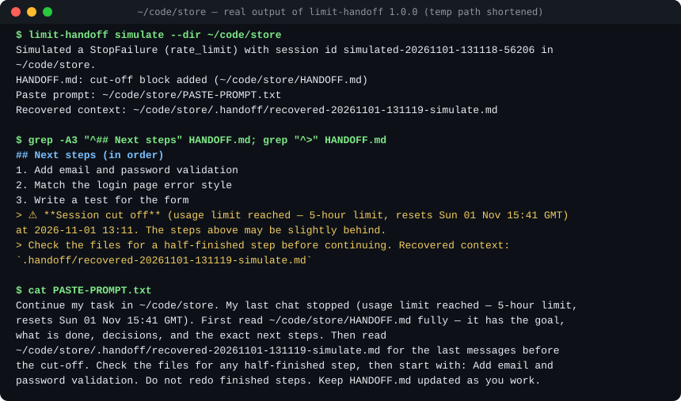

# limit-handoff

**When Claude Code hits a usage limit, keep going in a new chat — on any account or machine.**

[](https://github.com/nicholas-a-saunders/limit-handoff/actions/workflows/ci.yml)
[](https://github.com/nicholas-a-saunders/limit-handoff/releases)
[](LICENSE)

A Claude Code plugin. When a chat stops on a usage, rate or billing limit, it writes three things into your project:

- a **"Session cut off" block in `HANDOFF.md`** (or a new `HANDOFF.md` built from the chat), with the goal, what is done and the next steps,
- a **recovered context file** with your last messages, the task list, the files edited, the last commands, git state and Claude's last reply,
- a **paste prompt** (`PASTE-PROMPT.txt`, also copied to your clipboard) that a new chat can start from.

Open a new chat, paste, and carry on at the next step. Plain bash and jq. No network calls.



---

## Install

You need Claude Code 2.1.78 or newer, bash 3.2 or newer, and jq (see [Requirements](#requirements)).

```bash
claude plugin install limit-handoff --marketplace nicholas-a-saunders/limit-handoff
```

That adds this repository as a marketplace and installs the plugin. Restart Claude Code to load the hooks. To do it in two steps, or from inside a chat with `/plugin`:

```bash
claude plugin marketplace add nicholas-a-saunders/limit-handoff
claude plugin install limit-handoff@limit-handoff
```

To remove it: `claude plugin uninstall limit-handoff@limit-handoff`.

Context cost: about 70 tokens per session, for the description of the bundled `handoff` skill. The four hooks add nothing to the model's context.

<details>
<summary>Without the plugin system: add the hooks to a settings file</summary>

Clone the repository, then let the installer add the four hooks to a settings file you name. It changes nothing unless you pass `--settings`, makes a backup first, and keeps your other hooks.

```bash
git clone https://github.com/nicholas-a-saunders/limit-handoff.git
cd limit-handoff
bin/limit-handoff install --settings ~/.claude/settings.json --dry-run   # shows the change, writes nothing
bin/limit-handoff install --settings ~/.claude/settings.json
bin/limit-handoff status  --settings ~/.claude/settings.json            # check
```

The hook commands point at this folder by full path, so do not move it afterwards (or run `uninstall` and `install` again). To remove only the kit's hooks: `bin/limit-handoff uninstall --settings ~/.claude/settings.json`.

Use the plugin **or** the settings hooks, not both: both at once run every hook twice. `install` and `doctor` warn when they find the plugin turned on.

</details>

## Try it safely first

`simulate` runs the real hook on a made-up chat that ends on a 5-hour limit. It writes only into the folder you give, and it never touches your clipboard unless you add `--copy`.

```bash
DEMO="$(mktemp -d)"
bin/limit-handoff simulate --dir "$DEMO"     # plugin users: ask Claude to run `limit-handoff simulate --dir <a temp folder>`
cat "$DEMO/HANDOFF.md" "$DEMO/PASTE-PROMPT.txt"
```

The picture above is real `simulate` output. With the plugin, the `limit-handoff` command is on the PATH of Claude's Bash tool, so you can ask Claude to run it. In your own terminal, use `bin/limit-handoff` from a clone of this repository.

---

## Why not just wait?

Claude Code has a built-in setting, **"Continue automatically at usage limit"** (`autoContinueAtUsageLimit`). It waits in the **same open session** and goes on when the limit resets. If that fits your case, use it. limit-handoff covers what it does not:

| Situation | Built-in auto-continue | limit-handoff |
|---|---|---|
| Same chat, same account, you can wait for the reset | yes | writes a handoff too (harmless) |
| Carry on **now** on another account | no | yes: paste the prompt into the other account's chat |
| Carry on on **another machine** (same files through git or sync) | no | yes |
| The session was closed, or the terminal was killed | no | yes, if the hook ran; otherwise the next chat's catch-up writes it |
| A **weekly** limit (reset days away) | no | yes |
| API-key users, `claude -p` scripts, auto-continue turned off or failing | no | yes |
| A chat that ended on "Prompt is too long" | no | yes, through the catch-up at the next start |

You can use both. Auto-continue will simply find the handoff already written.

---

## What happens on a limit

```
Claude Code stops with a usage, rate or billing limit
        |
        v
StopFailure hook (rate_limit | billing_error | unknown)
        |
        +--> reads the end of the transcript (only reads; nothing in it is run)
        +--> .handoff/recovered-<time>-<session>.md   (+ .handoff/LATEST.md)
        +--> HANDOFF.md: adds this chat's "Session cut off" block,
        |                or creates HANDOFF.md from the chat if there is none
        +--> PASTE-PROMPT.txt, clipboard, desktop notification
        v
New chat (any account, same files): paste the prompt. It reads HANDOFF.md,
then the recovered file, checks for a half-finished step, and starts at the next step.
```

The four hooks:

| Hook | When | What it does |
|---|---|---|
| `StopFailure` | A chat stops on a limit error. | The steps above. Repeat events for the same chat within 120 s are ignored. |
| `SessionStart` | A chat starts or resumes. | **Catch-up:** if a recent chat in this project ended on a limit (or on "Prompt is too long") with no handoff, writes it now. Then, if `HANDOFF.md` has an unresolved cut-off, tells Claude to read it and names the first next step. |
| `UserPromptSubmit` | You send a message. | A short reminder to read `HANDOFF.md`: once per session, then when the file is stale. |
| `PreCompact` | Before Claude Code compacts a long chat. | Saves a snapshot to `.handoff/recovered-<time>-<session>-precompact.md`. |

Every hook always exits 0 and never blocks Claude Code. Timeouts: StopFailure 30 s, SessionStart 20 s, PreCompact 30 s, UserPromptSubmit 5 s.

**The cut-off block** sits between two marker comments in `HANDOFF.md`. It names the reason ("usage limit reached — 5-hour limit, resets Sun 01 Nov 15:41 GMT"), the time of the cut-off and the recovered file. Your own text is never changed. Each chat gets its own block. When the new chat has picked up the work, mark the block as done (it stays as history):

```bash
limit-handoff resolve                      # all unresolved blocks
limit-handoff resolve --session <id>       # one chat, when several were cut off
```

---

## Safety and privacy

**What it reads:** the end of the transcript file Claude Code already keeps on your disk (at most the last 32 MB and `LIMIT_HANDOFF_TAIL_LINES` lines), `HANDOFF.md`, its config files, and git state through read-only commands with repository-run programs turned off (no fsmonitor, filters, external diff or textconv).

**What it writes:** only the files in [Files it writes](#files-it-writes), inside your project and its state folder. Plus the clipboard and a desktop notification, which you can turn off.

**What it sends:** nothing. No network calls, no telemetry.

**What it runs:** nothing it reads. Transcript text, `HANDOFF.md` and config files are treated as plain text. Clipboard and notification tools are the standard ones (`pbcopy`, `wl-copy`, `xclip`, `xsel`, `clip.exe`, `osascript`, `notify-send`, `terminal-notifier`).

**Cloned repositories cannot steer it.** A repository you clone may ship its own `.claude/limit-handoff.conf`, but these keys are read only from the environment or your user config, never from the project file: `LIMIT_HANDOFF_FILE`, `_PROMPT_FILE`, `_RECOVER_DIR`, `_TAIL_LINES`, `_KEEP`, `_FOLLOW_LINKS`, `_CLIPBOARD`, `_NOTIFY`, `_STATE_DIR`. A `HANDOFF.md`, `PASTE-PROMPT.txt`, `LATEST.md` or recovered file that is a symbolic link out of the project, or into `.git` or `.claude`, is not read or written. If you keep `HANDOFF.md` as a link on purpose (for example into a dotfiles folder), set `LIMIT_HANDOFF_FOLLOW_LINKS=1` in your own config.

**Less private text on disk.** Recovered text has control characters, direction marks and backticks removed from paths and commands, and token-shaped strings (API keys, GitHub and Slack tokens, AWS key ids, long hex or base64 runs) are replaced with `[redacted]`. A `HANDOFF.md` that the kit creates does not copy your recent messages; they stay in the recovered file.

**Keep chat text out of git.** `.handoff/` gets its own `.gitignore` (`*`). `PASTE-PROMPT.txt` and an auto-created `HANDOFF.md` are made from chat text, so check them before you commit them. Many people add these lines to `.gitignore`:

```gitignore
.handoff/
PASTE-PROMPT.txt
HANDOFF.md
```

**Undo:** `claude plugin uninstall limit-handoff@limit-handoff`, or `limit-handoff uninstall --settings <file>` (it keeps a backup). Then delete `.handoff/`, `PASTE-PROMPT.txt`, the cut-off blocks in `HANDOFF.md`, and the state folder.

---

## Requirements

- **Claude Code 2.1.78 or newer** (the version that added the `StopFailure` hook). `limit-handoff doctor` checks it.
- **bash 3.2 or newer.** macOS ships bash 3.2, so nothing extra is needed there.
- **jq.** `brew install jq` on macOS, or your Linux package manager. Without jq the hooks still write the cut-off block and the paste prompt, but the recovered file has only a short note, and `install`/`simulate` stop with a clear message.
- **git** (optional) for the repository section in the recovered file.
- **macOS or Linux.** CI runs the tests on both. Windows is not tested.

---

## Files it writes

| File | What it is |
|---|---|
| `HANDOFF.md` | Your handoff file. The kit adds or updates only its own cut-off block, or creates the file when it is missing. |
| `PASTE-PROMPT.txt` | The paste prompt for a new chat. A file here that the kit did not write is first copied to `PASTE-PROMPT.txt.bak-<time>`. |
| `.handoff/recovered-<time>-<session>.md` | Recovered context. The newest 30 are kept (`LIMIT_HANDOFF_KEEP`); files that an unresolved block names are never deleted. |
| `.handoff/recovered-<time>-<session>-precompact.md` | Snapshot before compaction (counted separately). |
| `.handoff/LATEST.md`, `.handoff/.gitignore` | A copy of the newest recovered file; a `*` rule so git ignores the folder. |
| `<state folder>/…` | Log (`limit-handoff.log`), per-chat markers, and a fallback place for the recovered file and the paste prompt when the project folder cannot take them. |

The state folder is `$CLAUDE_PLUGIN_DATA` for the plugin, otherwise `~/.local/state/limit-handoff`. Change it with `LIMIT_HANDOFF_STATE_DIR`.

---

## Configuration

Nothing needs to be set. Each key is read in this order, the first found wins: environment variable, project file `<project>/.claude/limit-handoff.conf`, user file `~/.config/limit-handoff/config` (or under `$XDG_CONFIG_HOME`), built-in default. Files are read as `KEY=VALUE` lines and never run. [`config/limit-handoff.conf.example`](config/limit-handoff.conf.example) is a commented copy.

Keys marked **user only** are never read from the project file.

| Key | Default | Meaning |
|---|---|---|
| `LIMIT_HANDOFF_ERRORS` | `rate_limit billing_error unknown overloaded server_error` | Stop codes that make a handoff, inside the hook. The plugin's matcher only starts the hook for `rate_limit`, `billing_error` and `unknown`. |
| `LIMIT_HANDOFF_CREATE_IF_MISSING` | `1` | Create `HANDOFF.md` from the chat when it is missing. |
| `LIMIT_HANDOFF_PROMPTS` | `5` | How many of your last messages go into the recovered file. |
| `LIMIT_HANDOFF_GIT` | `1` | Add the git section to recovered files. |
| `LIMIT_HANDOFF_CATCHUP` | `1` | At a new chat, write a missing handoff for a recent chat that ended on a limit. |
| `LIMIT_HANDOFF_CATCHUP_HOURS` | `48` | How far back the catch-up looks (it reads at most 3 chats and stops starting new ones after 10 s). |
| `LIMIT_HANDOFF_DEBOUNCE_SEC` | `120` | Ignore a repeat StopFailure for the same chat within this many seconds. |
| `LIMIT_HANDOFF_REMIND` | `stale` | When the "read HANDOFF.md" reminder shows: `always`, `stale` or `off`. |
| `LIMIT_HANDOFF_STALE_MIN` | `20` | Minutes before `HANDOFF.md` counts as stale. |
| `LIMIT_HANDOFF_CLIPBOARD` | `auto` | **User only.** `auto`, `off`, or a bare command name on your PATH such as `pbcopy` (paths are refused). |
| `LIMIT_HANDOFF_NOTIFY` | `auto` | **User only.** `auto` or `off`. |
| `LIMIT_HANDOFF_FILE` | `HANDOFF.md` | **User only.** Handoff file name, inside the project. |
| `LIMIT_HANDOFF_PROMPT_FILE` | `PASTE-PROMPT.txt` | **User only.** Paste prompt file name, inside the project. Never the handoff file. |
| `LIMIT_HANDOFF_RECOVER_DIR` | `.handoff` | **User only.** Folder for recovered files, inside the project. |
| `LIMIT_HANDOFF_TAIL_LINES` | `4000` | **User only.** How many transcript lines to read from the end. |
| `LIMIT_HANDOFF_KEEP` | `30` | **User only.** Recovered files to keep; `0` keeps all. |
| `LIMIT_HANDOFF_FOLLOW_LINKS` | `0` | **User only.** `1` allows links that point outside the project. |
| `LIMIT_HANDOFF_STATE_DIR` | see above | **User only.** Log and marker folder. |

File names must stay inside the project and may not point into `.git` or `.claude`. A bad value is logged and the default is used.

---

## Command line

```
limit-handoff install   --settings FILE [--errors LIST] [--events LIST] [--dry-run]
limit-handoff uninstall --settings FILE [--dry-run]
limit-handoff status    [--settings FILE] [--dir DIR]
limit-handoff prompt    [--dir DIR] [--no-copy]
limit-handoff recover   --transcript FILE [--dir DIR] [--stdout]
limit-handoff resolve   [--dir DIR] [--session ID]
limit-handoff simulate  [--dir DIR] [--error CODE] [--transcript FILE] [--copy]
limit-handoff doctor    [--settings FILE]
limit-handoff --help | --version
```

| Command | What it does |
|---|---|
| `install` / `uninstall` | Add or remove the kit's hooks in a settings file you name. Backup first, `--dry-run` writes nothing, your other hooks stay. `--errors` sets the StopFailure codes (default `rate_limit\|billing_error\|unknown`); `--events` picks hooks from `stop-failure,prompt-submit,session-start,pre-compact` (kit hooks not listed are removed, and the command says which). |
| `status` | The handoff file's age, unresolved cut-offs, recovered files, installed kit hooks, last log lines. |
| `prompt` | A manual handoff now: builds and prints the paste prompt and copies it (unless `--no-copy`). Use it before you end a chat on purpose. |
| `recover` | Build a recovered-context file from any transcript (`--stdout` prints it). |
| `resolve` | Mark cut-off blocks as resolved. The history stays. |
| `simulate` | Run the real hook on a fake stop (see [Try it safely](#try-it-safely-first)). |
| `doctor` | Check bash, jq, clipboard, notifications, the state folder, the Claude Code version, and hooks registered twice. Read only. |

`--dir` is the project folder; without it the kit uses `CLAUDE_PROJECT_DIR`, then the current folder. Exit codes: `0` ok, `1` something failed, `2` wrong usage (or a settings file that is not valid JSON).

---

## Add this to your CLAUDE.md

The hooks work on their own. A `HANDOFF.md` that Claude keeps up to date during the chat makes the handoff much better. Paste this into your project or user `CLAUDE.md` (full text in [`templates/claude-md-snippet.md`](templates/claude-md-snippet.md)):

```markdown
## Keep HANDOFF.md current

For any task with more than one or two steps, or any task that edits files:

1. At the start, create or read `HANDOFF.md` in the project root. If it exists, read it first and continue from it.
2. Keep it accurate, not long. Update it after each finished step, before any long or risky action, when the goal changes, and before the final reply.
3. Keep these headings: Goal, Status, Done so far, Next steps (in order), Key decisions & user preferences, Important facts / findings, Open questions / risks, Paste prompt (for a new chat).
4. Keep the current paste prompt at the bottom of `HANDOFF.md`.
5. If a `Session cut off` block appears in `HANDOFF.md`, read it and the recovered context file it names. Check the files for a half-finished step before you continue. Then run `limit-handoff resolve`.
```

The plugin also adds a `/limit-handoff:handoff` skill: it saves the full task state to `HANDOFF.md` and prints a paste prompt, for when you want to move to a new chat yourself.

---

## Known limits

- **Claude Code must run the StopFailure hook.** It does not always:
  - In headless mode (`claude -p`), external programs started by a StopFailure hook can be killed early ([anthropics/claude-code#101420](https://github.com/anthropics/claude-code/issues/101420)). The next chat's catch-up then writes the handoff.
  - "Prompt is too long" fires no StopFailure ([#104951](https://github.com/anthropics/claude-code/issues/104951)). Catch-up covers it at the next start.
  - Background subagents can fire StopFailure on the parent session ([#91419](https://github.com/anthropics/claude-code/issues/91419)). The kit ignores subagent lines and repeat events within 120 s.
- **Limit type and reset time come from the transcript**, because the hook input does not carry them ([#97975](https://github.com/anthropics/claude-code/issues/97975), [#98012](https://github.com/anthropics/claude-code/issues/98012)). Treat the reset time as a guide.
- **The transcript format is internal to Claude Code** and can change. Lines the parser does not understand are skipped, so recovery degrades rather than fails.
- **Only the end of a long chat is read.** The first request can fall outside it; the created `HANDOFF.md` then says the goal was not found.
- **"Same files" means you share the project folder** with the new machine, through git or a sync tool. The handoff lives in the project.
- **A force-quit or sleep in the middle of a stop** can leave no files. The next chat's catch-up, or `limit-handoff prompt`, covers it.
- **Task lists are best effort** for TaskCreate/TaskUpdate, which are matched through Claude Code's reply text.
- **Windows is not tested.**

---

## How it compares

| Approach | Good at | Gap |
|---|---|---|
| Built-in auto-continue | No setup; same chat goes on after the reset | Same open session and account only |
| Resuming the old chat later | No setup | Same account, and the chat must still exist |
| Writing `HANDOFF.md` by hand, or CLAUDE.md rules alone | Full control; keeps the file fresh during work | Nothing runs at the moment of the cut-off; no paste prompt |
| **limit-handoff** | A ready handoff at the moment of the stop, for a new chat anywhere | Needs Claude Code to run the hook (catch-up covers most misses); reads an internal format |

---

## Development

```bash
/bin/bash tests/run.sh
```

484 tests, pure bash and jq, run on macOS (`/bin/bash` 3.2) and Ubuntu in CI. Each test gets a temp HOME and state folder, and clipboard, notification and `claude` are replaced by shims, so a run never touches your real setup. ShellCheck must pass at warning level:

```bash
shellcheck --shell=bash --severity=warning --external-sources bin/limit-handoff hooks/*.sh lib/common.sh
```

Design notes are in [`docs/DECISIONS.md`](docs/DECISIONS.md) and [`docs/SPEC.md`](docs/SPEC.md). See [CONTRIBUTING.md](CONTRIBUTING.md), [SECURITY.md](SECURITY.md) (report problems privately through GitHub) and [CHANGELOG.md](CHANGELOG.md).

Version 1.0.0. MIT licence, see [LICENSE](LICENSE).

Not affiliated with or endorsed by Anthropic. "Claude" and "Claude Code" are trademarks of Anthropic.
